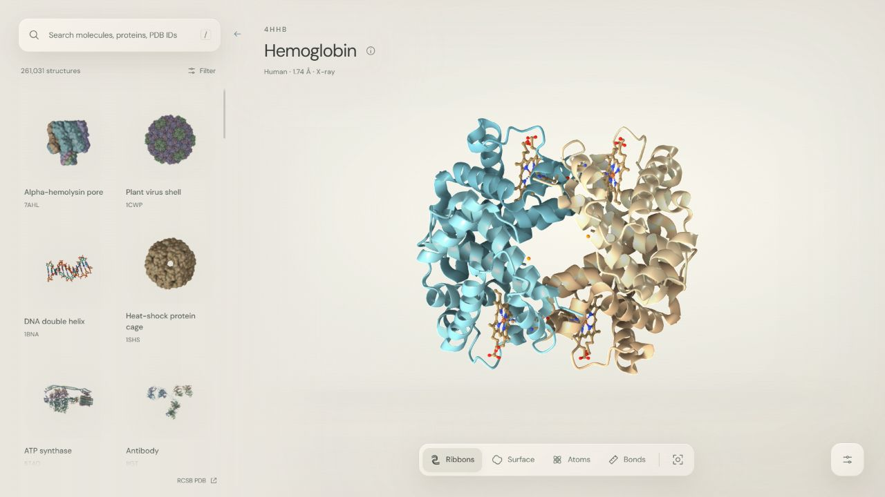

<p align="center">
  <picture>
    <source media="(prefers-color-scheme: dark)" srcset="md/media/protein-wiki-dark.svg">
    
  </picture>
</p>

<p align="center">A molecular explorer for the Protein Data Bank.</p>

<p align="center">
  <a href="https://github.com/MaeglynD/protein-wiki/actions/workflows/ci.yml"></a>
  <a href="https://molstar.org/"></a>
  <a href="https://www.rcsb.org/"></a>
</p>

<p align="center"><strong><a href="https://protein.wiki">Open protein.wiki ↗</a></strong> · <a href="#run-locally">Run locally</a> · <a href="#controls">Controls</a> · <a href="md/USAGE.md">Technical guide</a></p>


<p align="center"><sub>Hemoglobin · PDB 4HHB · Porcelain</sub></p>

## Explore

- **Find a structure.** Search the experimental PDB by name, partial word, organism, ligand or PDB ID. Start with a curated collection of 44 varied structures.
- **See its form.** Switch between ribbons, surfaces, atoms and bonds. Five themes keep the scene and controls coherent.
- **Inspect its parts.** Focus residues, isolate chains and ligands, and measure atom-to-atom distances.
- **Keep a view.** Export an image or share a link containing the structure, representation, colours and camera.

## Run locally

Use Node.js 22.12+ and [pnpm](https://pnpm.io/installation) 10.

```sh
git clone https://github.com/MaeglynD/protein-wiki.git
cd protein-wiki
pnpm install --frozen-lockfile
pnpm dev
```

Open **http://127.0.0.1:5187**. No API key or database is required.

`pnpm build` creates `dist/`. `pnpm test` checks coordinate-download recovery. See [deployment](md/DEPLOYMENT.md) for Cloudflare setup.

## Controls

| Action | Control |
| :--- | :--- |
| Rotate / zoom / pan | Drag / scroll or pinch / right-drag |
| Inspect a residue | Click the structure |
| Search | `/` |
| Fit the whole structure | `R` |
| Hide or show the catalogue | `F` |
| Cycle themes | `T` |

<details>
<summary><strong>Data, rendering &amp; scientific notes</strong></summary> 

protein.wiki uses experimental coordinates from [RCSB PDB](https://www.rcsb.org/) and the [Mol*](https://molstar.org/) renderer. This is a browser-based viewer; WebGL is required, and live archive search needs an internet connection.

Colours are illustrative. Surface mode shows a smoothed Gaussian envelope, not electron density. Camera movement is not molecular dynamics. Each structure links to its experimental record.

PDB coordinates are CC0; Mol* is MIT-licensed; fonts use the SIL Open Font License. See [credits and dependency licences](public/credits.txt), [research](md/RESEARCH.md) and [verification notes](md/VERIFICATION.md).

</details>
